# Character Lab

**Draw characters in code, and measure how close you got.**

Character Lab is a small lab for characters that are drawn entirely by code: outlines, materials and a rig rendered
by a WebGL2 renderer, with no images used at render time. Every part of a character is checked against a reference
sheet, side by side, with a score, so you can tell whether a change to the drawing actually helped.

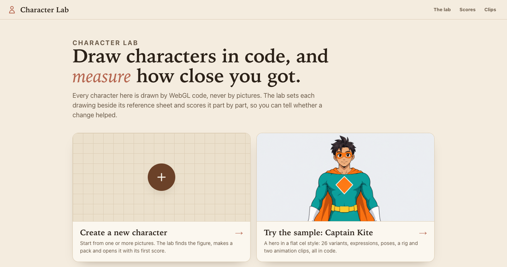

It ships with one example character, **Captain Kite**, whose code and sheets you're free to use.

## Get started: just ask your agent

You don't need to learn any commands. Your AI agent installs the lab, creates your character and opens it for you.

### 1. Add the lab to your agent

| Agent | Type this in the agent |
|-------|------------------------|
| **Claude Code** | `/plugin marketplace add CharacterLab/CharacterLab` then `/plugin install character-lab@character-lab` |
| **Codex** | `codex plugin marketplace add CharacterLab/CharacterLab` then `codex plugin add character-lab@character-lab` |
| **Any other agent** (Cursor, …) | nothing: paste a prompt from step 2, starting with *"Clone https://github.com/CharacterLab/CharacterLab.git and read AGENTS.md."* |

The plugin brings the lab's [skills](skills/) and its tools (an [MCP server](mcp/)): your agent can start the lab,
create a character from your pictures, score it and show you comparisons.

### 2. Ask, in your own words

```text
Install Character Lab and show me the sample character.
```

```text
Add my character to Character Lab from this picture: /path/to/my-character.png
Call him "Max". Draw him in code until he looks right, then open him in the lab.
```

```text
I don't have a picture yet. Make a reference picture of a friendly robot girl with a red scarf,
then add her to Character Lab and show me the lab.
```

Your agent checks that Node.js 22.12+ and Google Chrome are installed, and tells you if something is missing.

### Or do it yourself in the lab

Open the lab, press **New character**, drop in your pictures, check the crop it found and press **Create**:

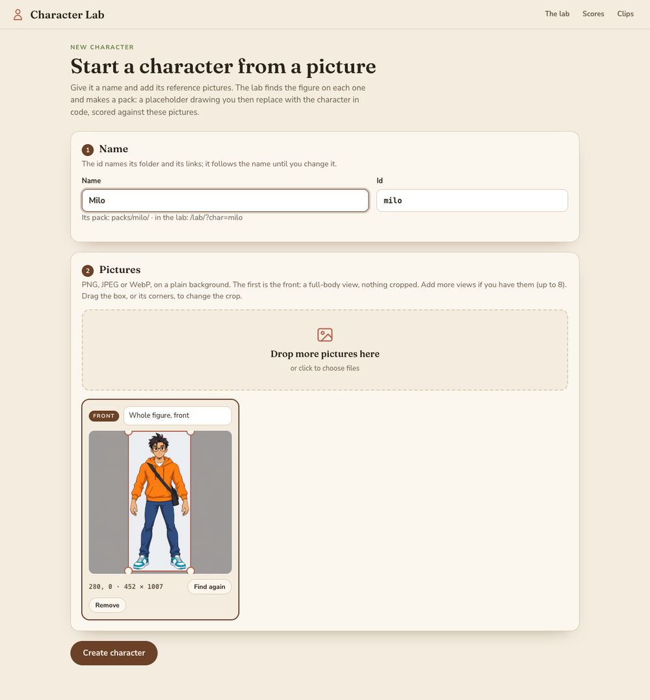

The lab makes the pack and opens it next to your picture with its first score. It starts as a placeholder shape, and
your agent (or you, in code) then draws the character to match:

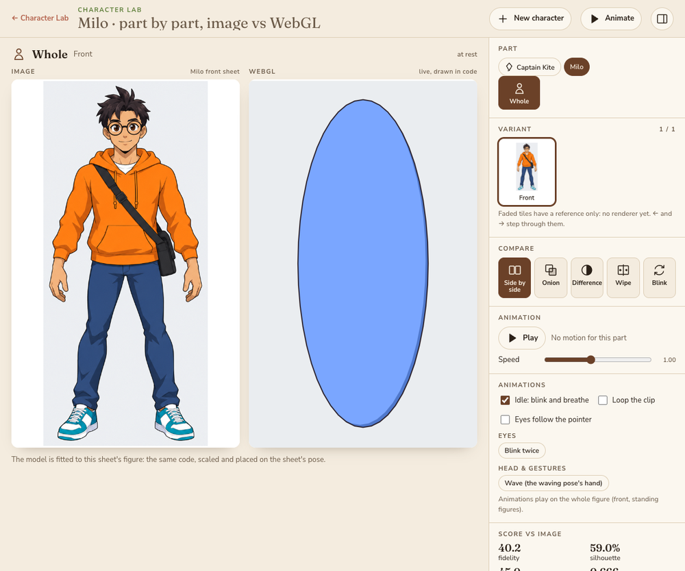

Or press **Try the sample** to look around with Captain Kite:

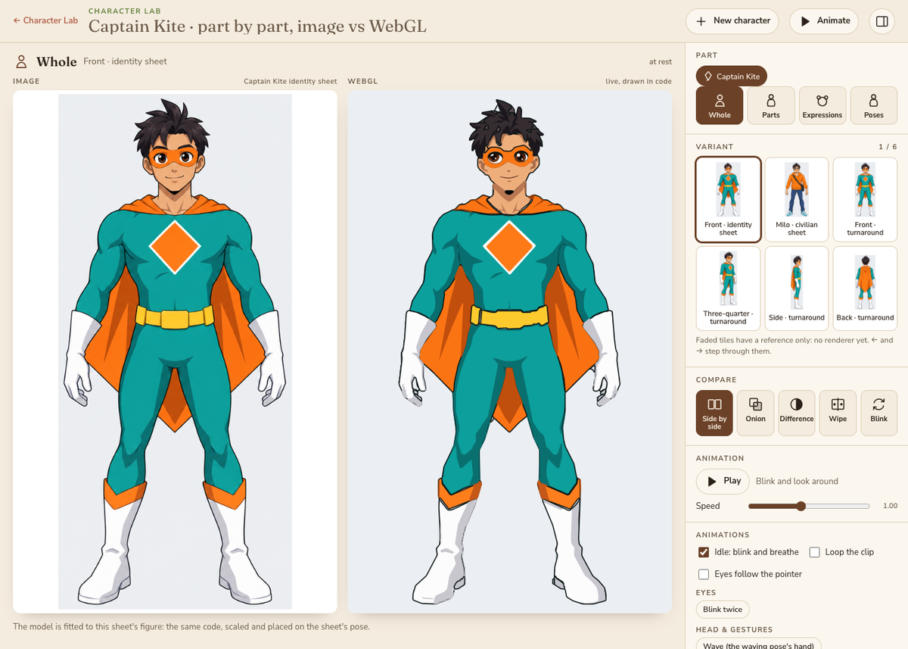

See [Quick start](#1-quick-start) to run it without an agent.

---

## Contents

1. [Quick start](#1-quick-start)
2. [A tour of the lab](#2-a-tour-of-the-lab)
3. [Meet Captain Kite](#3-meet-captain-kite)
4. [Guide: make your own character](#4-guide-make-your-own-character)
5. [Keep your characters in their own repository](#5-keep-your-characters-in-their-own-repository)
6. [Give a character its own look](#6-give-a-character-its-own-look)
7. [Command line reference](#7-command-line-reference)
8. [Folder map](#8-folder-map)
9. [License](#9-license)

---

## 1. Quick start

You need **Node.js 22.12+** and, for command-line scoring, **Google Chrome** (set `CHROME=/path/to/chrome` if it isn't in
the usual place).

```bash
git clone https://github.com/CharacterLab/CharacterLab.git
cd CharacterLab
npm ci
npm start          # open http://localhost:8765/
```

The home page offers two ways in: **Create a new character** from your own pictures, or **Try the sample**, Captain
Kite, in the lab at <http://localhost:8765/lab/>. To check everything works:

```bash
npm test                 # the engine's tests and every pack's own tests
npm run lab -- score     # every variant's score, in headless Chrome
```

To start a character of your own from a picture, use the lab's **New character** page
(<http://localhost:8765/lab/new.html>): name it, drop in one or more pictures (the first is the front), check the
crop the lab found, and press Create. The same from the command line:

```bash
npm run new-pack -- star-girl --sheet=path/to/front.png --label="Star Girl"   # --box=x,y,w,h to set the crop yourself
```

---

## 2. A tour of the lab

### The lab: the sheet next to the code

Pick a character and a **part** (the whole figure, parts, expressions, poses), then a **variant**, which is one crop of
a reference sheet. The painting is on the left, and the live WebGL drawing is on the right.

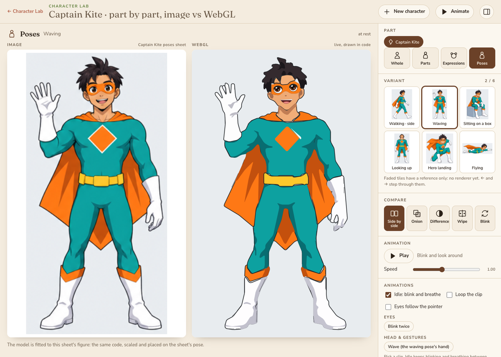

### Compare modes

Five ways to see the gap: **side by side**, **onion** (overlaid), **difference**, **wipe** and **blink**. The same view is
available from the command line: painting | code | difference.

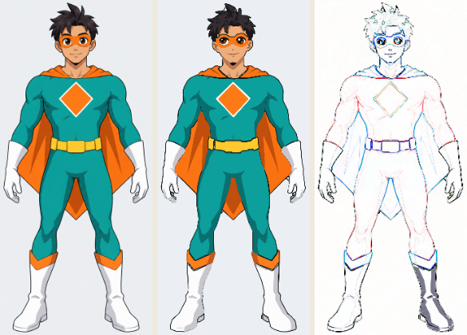

The difference panel shows where the drawing is off: white is a match, colour is a miss.

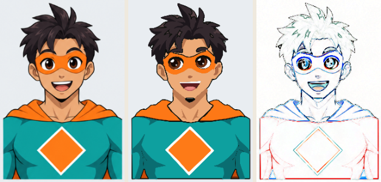

### Scores

Every variant gets a **fidelity** score (0–100) made of silhouette overlap, colour distance (ΔE), palette, structure
(SSIM), contrast, edges and texture. Save a baseline, change the code, and compare the two.

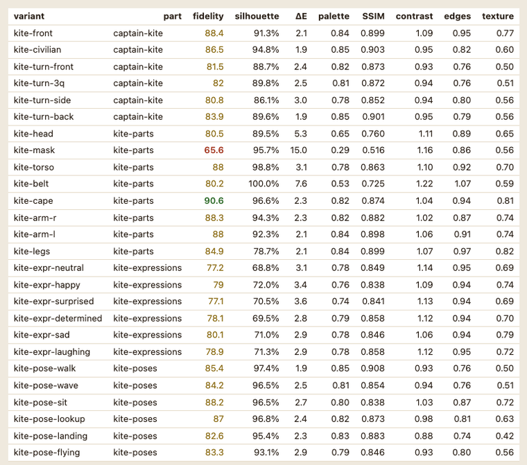

### Faces, rigs and clips

A character can expose **face params** (eyes, lids, gaze, brows, mouth, blush), shown as buttons and sliders in the
lab, plus a **rig** of parts that **clips** move over time. `anim.html` and `npm run lab -- film` lay a clip out as a
filmstrip.

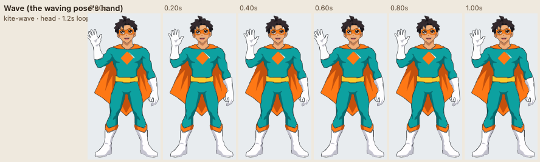

---

## 3. Meet Captain Kite

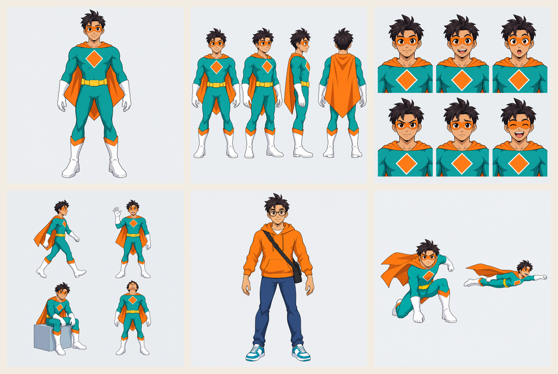

**Milo Reyes** is a shy bike courier. When someone needs help, he becomes **Captain Kite**, a hero who rides the wind.
He's drawn in a flat anime cel style with the engine's **cel material**: a flat colour, one hard shadow, a rim light and an
even outline.

| Part | Variants |
|------|----------|
| Whole | front, Milo in street clothes, turnaround (front, three-quarter, side, back) |
| Parts | head, mask and eyes, torso and emblem, belt, cape, both arms, legs |
| Expressions | neutral, happy, surprised, determined, sad, laughing |
| Poses | walking, waving, sitting, looking up, hero landing, flying |

That's 26 variants with a mean score of about 83, plus face presets, an outfit switch (`outfit: "civilian"`), a rig,
and two clips (`kite-wave`, `kite-blink`).

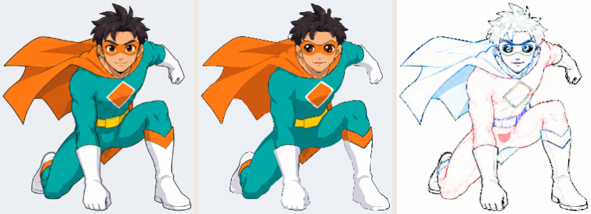

How he's built (`packs/captain-kite/`):
- `kite-shapes.js` holds his flat colour regions as outlines, with their colours and shadow settings. It's generated
  from the sheets by `tools/trace-sheets.py` (Python, numpy, scipy, Pillow), so you can remake it.
- `kite-face.js` draws the eyes, brows, nose and mouth in code, so the face can change expression.
- `captain-kite.js` holds the variants, the face presets, the rig and the clips, and registers the character.

The sheets were generated for this project with OpenAI image generation through the Codex CLI. The whole pack, code and
sheets, is CC0.

---

## 4. Guide: make your own character

This walks through `examples/blob/`, the smallest character that works: one sheet, one variant and a blink.

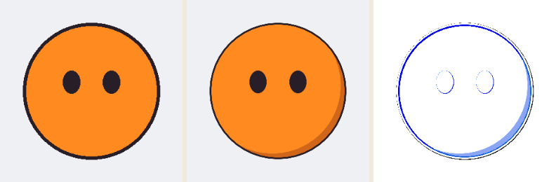

### Step 1: Make a reference sheet

Paint, draw or generate a picture of your character on a plain background and save it as a PNG. The box
(`x, y, width, height` in pixels) around the figure is the crop the lab scores; the New character page and
`npm run new-pack` find it for you, and you can set it by hand.

```
examples/blob/
  pack.json
  blob.js
  sheets/front.png      512 × 512, the figure inside [96, 96, 320, 320]
```

### Step 2: Describe the pack

`pack.json` names the pack, its license, the scripts to load (in order) and where its sheets are served from:

```json
{ "id": "blob", "label": "Blob", "version": "0.1.0", "engine": ">=0.1.0", "license": "CC0-1.0",
  "scripts": ["blob.js"], "sheetsBase": "/packs/blob/sheets/" }
```

### Step 3: Draw it in code

A `build(params)` function returns **draw ops**: shapes (lists of points) with a material. Work in the sheet's pixels,
measuring positions on the sheet.

```js
const CL = window.CharacterLab;
const { ellipse } = CL.lab.geom;                       // shared helpers: ellipse, spline, rng, flat
const INK = "#281e28";
const cel = (base, shade) => ({ type: 8, ramp: [shade, shade, base, base], line: INK, lineW: 3, shadow: 14, clean: true });

function build(p = {}) {
  const blink = p.eyes === "closed" ? 0.1 : 1;         // a face param from the lab
  return {
    world: [512, 512],
    ops: [
      { kind: "fill", pts: [[0, 0], [512, 0], [512, 512], [0, 512]],          // the backdrop
        mat: { type: 8, ramp: Array(4).fill("#eef0f3"), lineW: 0, shadow: 0, clean: true }, seed: 1 },
      { kind: "fill", pts: ellipse(256, 256, 120, 120), mat: cel("#ff8a1f", "#d0661a"), seed: 2 },   // body
      { kind: "fill", pts: ellipse(221, 240, 15, 20 * blink), mat: cel(INK, INK), seed: 3 },        // eyes
      { kind: "fill", pts: ellipse(291, 240, 15, 20 * blink), mat: cel(INK, INK), seed: 4 },
    ],
  };
}
```

### Step 4: Register the character

The pack's last script registers the sheets and the parts. A **variant** is a crop of a sheet (`frame`) plus the
`build` that draws it; `fit` maps sheet pixels onto the crop.

```js
CL.lab.registerCharacter({
  id: "blob", label: "Blob",
  sheetsBase: "/packs/blob/sheets/",
  sheets: { "blob-front": { file: "front.png", name: "blob front sheet" } },
  parts: [{
    id: "blob", label: "Whole", whole: true,
    variants: [{ id: "blob-front", label: "Front", sheet: "blob-front", kind: "mapped",
      frame: [96, 96, 320, 320], scale: 1, fit: { s: 1, tx: -96, ty: -96 }, build }],
  }],
});
```

### Step 5: Load it and score it

Point the lab at the folder that holds your pack:

```bash
LAB_PACKS=examples npm start                         # Blob appears in the lab
LAB_PACKS=examples npm run lab -- score --part=blob  # blob-front  90.3
LAB_PACKS=examples npm run lab -- sheet --v=blob-front --out=out/blob.png   # painting | code | difference
```

### Step 6: Improve, measure, repeat

1. Save a baseline: `npm run lab -- score --save=out/base.json`.
2. Change the drawing: a shape, a colour, the shadow.
3. Run `npm run lab -- score --compare=out/base.json` to see each variant's change, and `sheet --v=...` to see where.

When the whole figure reads well, add more: more variants (turnaround, expressions, poses) as crops of more sheets, an
`expressions` block for the lab's face buttons, and a `rig` and `clips` for animation. Captain Kite's pack shows
each of these. `packs/README.md` documents every field of `pack.json` and `registerCharacter`, and `checkPack` tests a
pack against those rules (call it from your pack's `tests/`).

---

## 5. Keep your characters in their own repository

Your characters don't have to live in this repository. Put them in any folder, a private repository for example, and
list it in `lab.config.json` (git-ignored):

```bash
cp lab.config.example.json lab.config.json
```

```json
{
  "packs": ["../my-character-packs"],
  "mounts": { "/sheets/": "../my-reference-sheets/" }
}
```

- `packs`: folders of packs, relative to the lab. `LAB_PACKS` (colon-separated) adds more.
- `mounts`: other folders served read-only on the same port, if a pack's sheets live elsewhere.
- `newPacksDir`: where the New character page makes packs (default: the lab's own `packs/`; `LAB_NEW_PACKS` too).

The server lists every pack at `/packs.json`, serves each one read-only at `/packs/<id>/` (its `tests/` and `tools/`
stay private), and the pages load them in their `order`. Its one write is `POST /api/characters`, which the New
character page uses to make a pack; it answers only the lab's own page. With no packs at all, the lab opens with a short message
saying so.

---

## 6. Give a character its own look

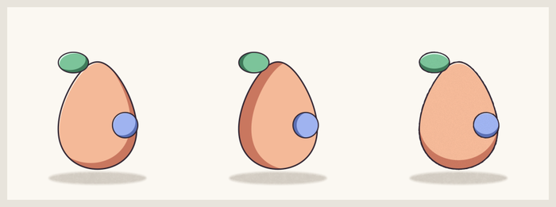

The renderer (`lab/js/wc-gl.js`) draws layers of ops, each an SDF shape with a material. The built-in materials
are:
- **painted** (the default): a soft wash with weak light, pigment blooms and paper grain;
- **pools**: soft-edged colour;
- **cel**: shown above;
- eyes, blush, halos and strokes.

A pack can add its own **materials and draw modes as GLSL**. A script named `*-gl.js` calls
`CharacterLab.wcGL.registerMaterial()` or `registerMode()`, and the engine splices those chunks into its shader before it
compiles. The loader runs every pack's `*-gl.js` first. A pack can also hold materials only (`"kind": "materials"`):
other packs then `"requires"` it to share one look. The API is documented at the top of `wc-gl.js`, and
`lab/cel.html` shows the cel material on its own.

---

## 7. Command line reference

| Command | What it does |
|---------|--------------|
| `npm run lab -- score` | every variant's score (`--part=`, `--v=`, `--save=`, `--compare=`, `--json`) |
| `npm run lab -- sheet --v=<id>` | painting \| code \| difference image for one variant |
| `npm run lab -- shot --url=<page>` | screenshot of a lab page once it's ready (`--url=/` the home page, `--full`) |
| `npm run lab -- film --clip=<id>` | a clip's frames as a filmstrip (`--frames`, `--zoom`, `--fps`) |
| `npm run lab -- board` / `check` / `packages` | group scores by family, guard a change, split work into packages |

The header of `lab/scripts/wc-lab.mjs` lists every option. Output goes to `out/` (git-ignored).

---

## 8. Folder map

```
index.html            home page: create a character, try the sample, every character found
server.mjs            local server (loopback only, browser assets only; its one write is lab-api.mjs)
lab-api.mjs           POST /api/characters: the New character page makes a pack
lab-config.mjs        finds packs and mounts (lab.config.json, LAB_PACKS)
lab/                  the engine
  index.html          the lab               score.html   scores      anim.html   clips
  new.html            a new character       cel.html     the cel material
  inspect.html, bake.html                   tools for figures scored with landmarks
  js/                 renderer, catalog, scoring, rig and clips, face params, pack API and loader
  scripts/            command line, pack maker (pack-maker.mjs, png.mjs), test runner
packs/                the lab's own packs: captain-kite/ and the pack format (README.md)
examples/blob/        the guide's tutorial character
docs/images/          the pictures in this README
tests/                server, config, pack API, loader and renderer tests
```

---

## 9. License

The code is **MIT** (`LICENSE`). The Captain Kite pack and the Blob example, code and sheets, are **CC0**
(`packs/captain-kite/LICENSE`, `examples/blob/LICENSE`). See `CONTRIBUTING.md` to help out.
